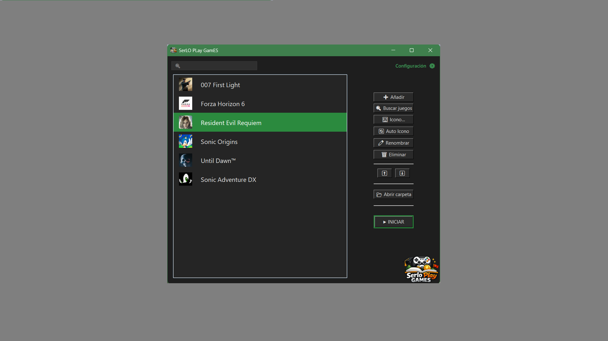
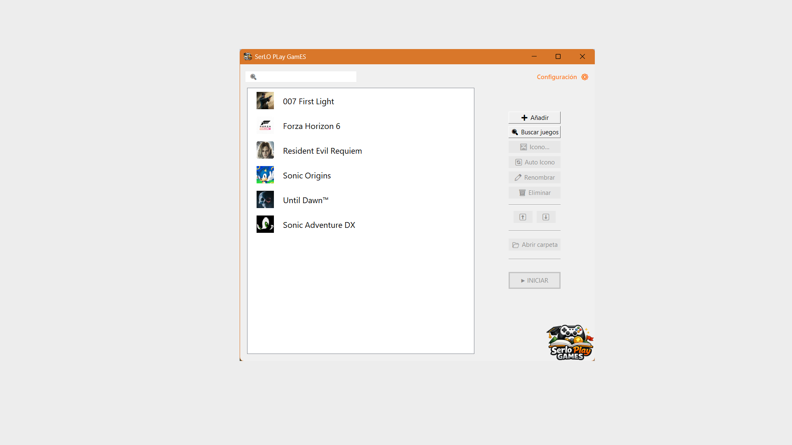
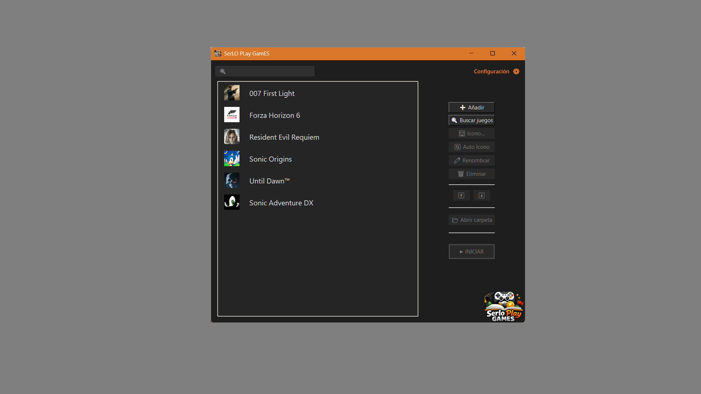
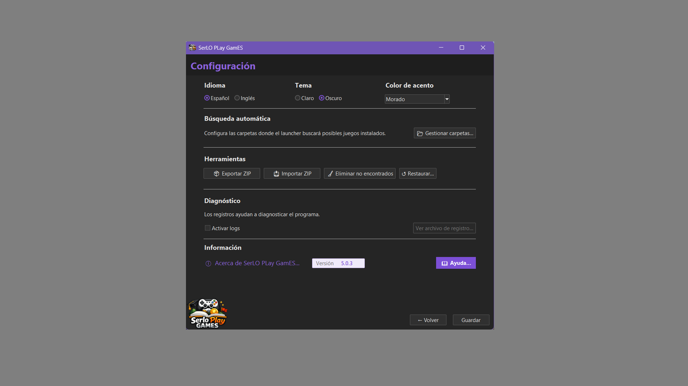
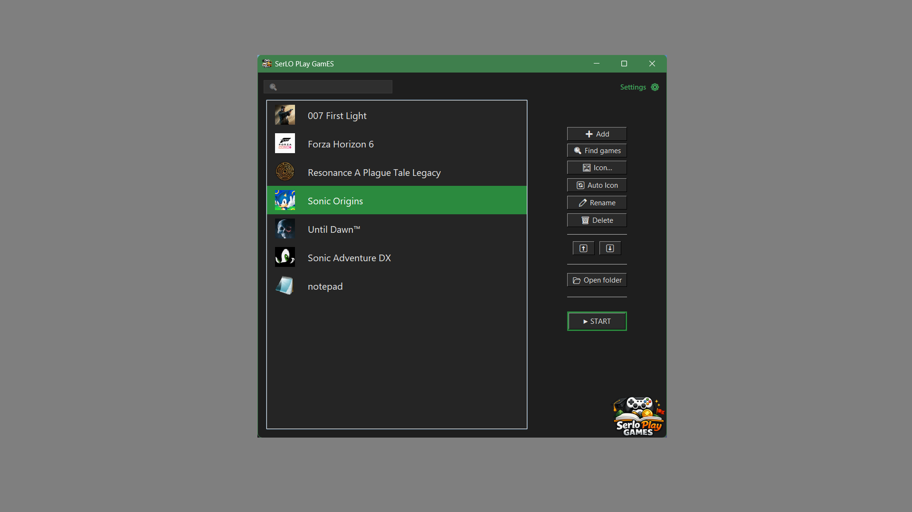
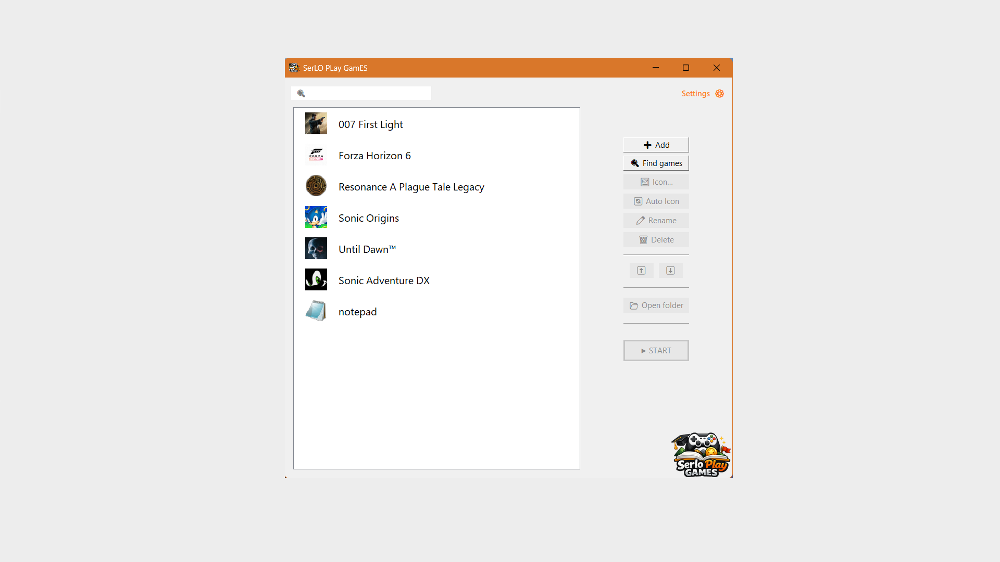
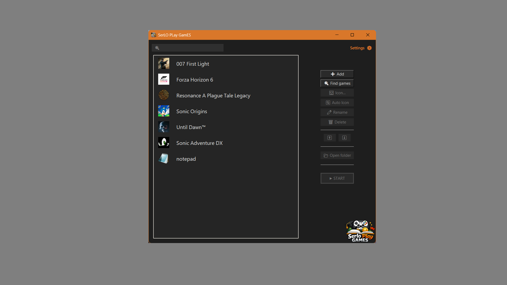
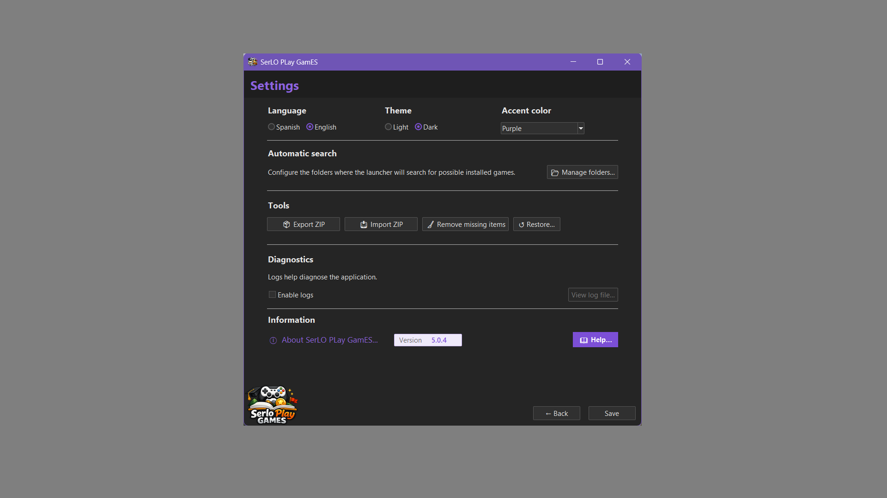

  

<h1 align="center">SerLO PLay GamES</h1>

  🚀 Free Windows launcher with automatic game search, customizable icons, Steam support, and accent colors

  Organize and launch your games, programs, and shortcuts from one place

  
  

  
  

  <a href="#-español">🇪🇸 Español</a> · <a href="#-english">🇬🇧 English</a>

---

#### 🇪🇸 Español

## 🧩 ¿Qué es?

SerLO PLay GamES es un **launcher gratuito para Windows** que permite organizar, ejecutar y personalizar juegos, programas y accesos directos desde un solo lugar.

Es compatible con archivos `.exe`, accesos directos de Windows `.lnk` y accesos directos de Internet `.url`, incluidos los accesos directos compatibles de Steam.

**Todas sus funciones son gratuitas, sin licencias, suscripciones ni activaciones.** Se instala y actualiza desde Microsoft Store.

---

## ⚙️ Características

- Biblioteca personal de juegos, programas y accesos directos.
- 🔎 Búsqueda automática de juegos instalados en las carpetas habituales de Steam, Epic Games, EA, Ubisoft, GOG y la aplicación Xbox para PC.
- Carpetas de búsqueda personalizables desde Configuración.
- Selección de los juegos encontrados antes de añadirlos y opción para añadir elementos manualmente.
- Iconos personalizados y asignación automática de iconos.
- 🎨 Colores de acento personalizables y temas claro y oscuro.
- 🔍 Buscador integrado y organización de la biblioteca.
- 🧹 Herramienta **Eliminar no encontrados** para limpiar elementos que ya no estén disponibles.
- 🔄 Restauración de ajustes y restablecimiento de la aplicación.
- 📦 Exportación e importación de biblioteca, configuración e iconos mediante copias de seguridad ZIP.
- 🌍 Interfaz disponible en español e inglés.
- ❤️ Opción de apoyo voluntario al proyecto desde **Acerca de**, sin ventajas ni funciones de pago.

---

## 🖼️ Capturas

  
  

  
  

---

## 📥 Descargar

**SerLO PLay GamES se distribuye gratuitamente a través de Microsoft Store.** No se ofrecen versiones portables públicas ni descargas desde GitHub Releases.

[**Descargar SerLO PLay GamES desde Microsoft Store**](https://apps.microsoft.com/detail/9PG5GK35KVZV)

Las actualizaciones se gestionan desde Microsoft Store.

---

## 🌐 Web oficial

- **Principal:** https://serlortrademark.github.io/serloplaygames/
- **Alternativa:** https://serloplaygames.pages.dev

---

## 💻 Requisitos

- Windows 10 o Windows 11 de 64 bits.
- Conexión a Internet para iniciar la aplicación.

---

#### 🇬🇧 English

## 🧩 What is it?

SerLO PLay GamES is a **free Windows launcher** that lets you organize, launch, and customize games, programs, and shortcuts from one place.

It supports `.exe` executable files, `.lnk` Windows shortcuts, and `.url` Internet shortcuts, including compatible Steam shortcuts.

**All features are free, with no licenses, subscriptions, or activation required.** It is installed and updated through Microsoft Store.

---

## ⚙️ Features

- Personal library for games, programs, and shortcuts.
- 🔎 Automatic scanning of installed games in common Steam, Epic Games, EA, Ubisoft, GOG, and Xbox app for PC folders.
- Customizable search folders in Settings.
- Choose which detected games to add, or add items manually.
- Custom icons and automatic icon assignment.
- 🎨 Customizable accent colors and light/dark themes.
- 🔍 Built-in search and library organization.
- 🧹 **Remove Missing** tool to clean up unavailable items.
- 🔄 Restore settings and reset the application.
- 📦 Export and import your library, settings, and icons using ZIP backups.
- 🌍 Interface available in English and Spanish.
- ❤️ Optional support for the project from **About**, without paid features or benefits.

---

## 🖼️ Screenshots

  
  

  
  

---

## 📥 Download

**SerLO PLay GamES is distributed for free through Microsoft Store.** Public portable versions and GitHub Releases downloads are no longer offered.

[**Get SerLO PLay GamES on Microsoft Store**](https://apps.microsoft.com/detail/9PG5GK35KVZV)

Updates are managed through Microsoft Store.

---

## 🌐 Official Website

- **Main:** https://serlortrademark.github.io/serloplaygames/
- **Alternative:** https://serloplaygames.pages.dev

---

## 💻 Requirements

- 64-bit Windows 10 or Windows 11.
- Internet connection required to start the application.
