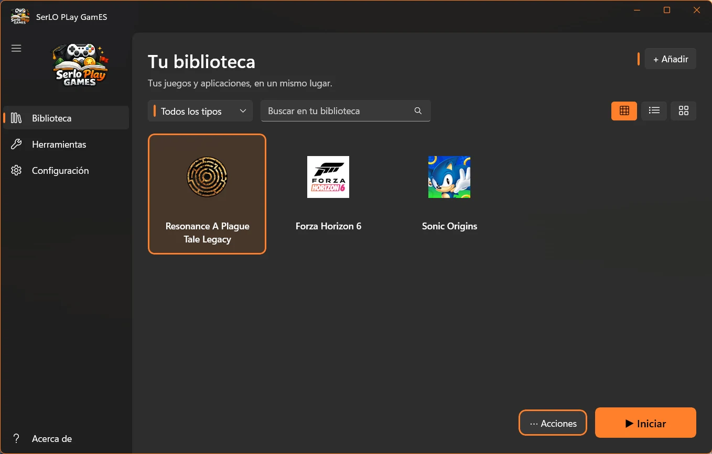
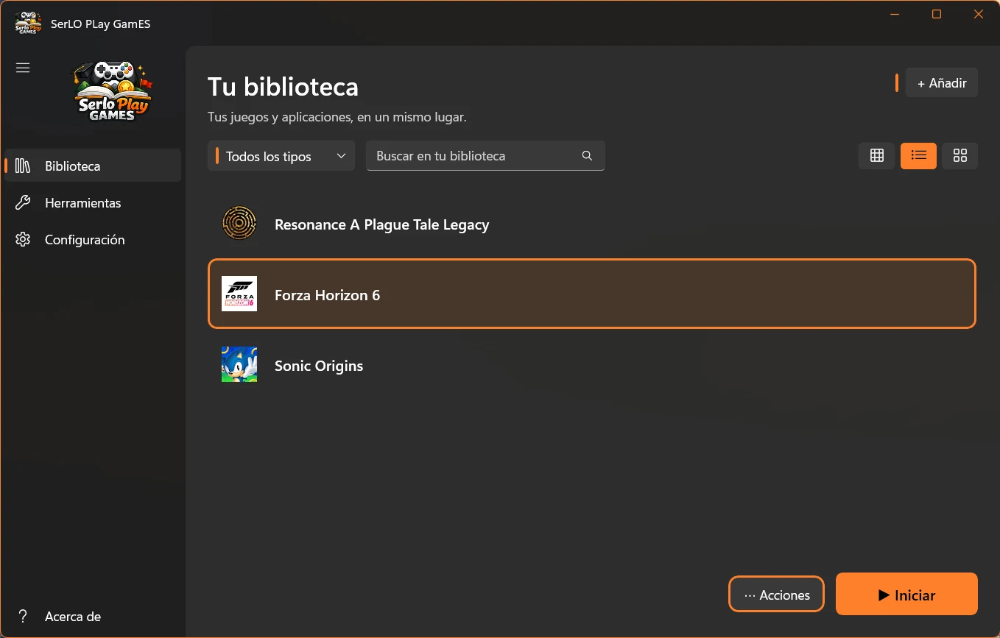
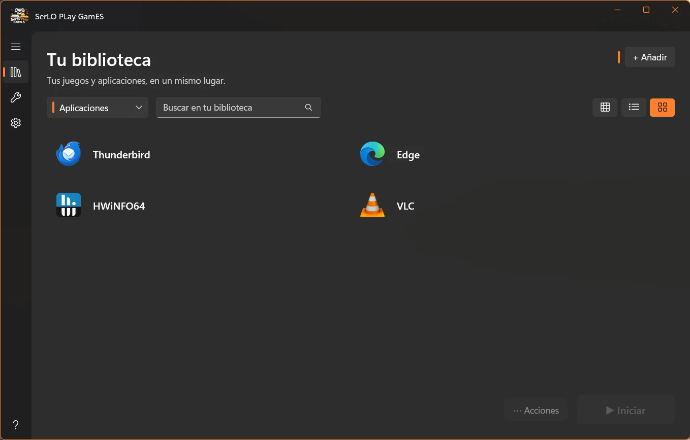
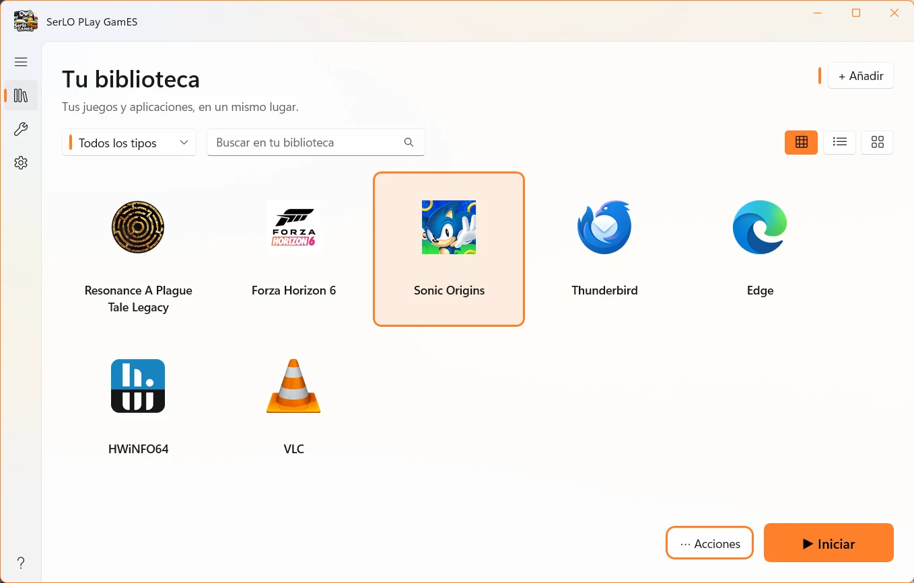
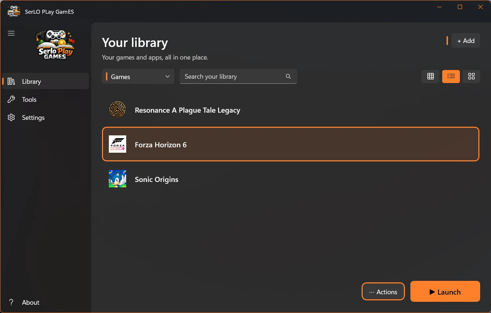
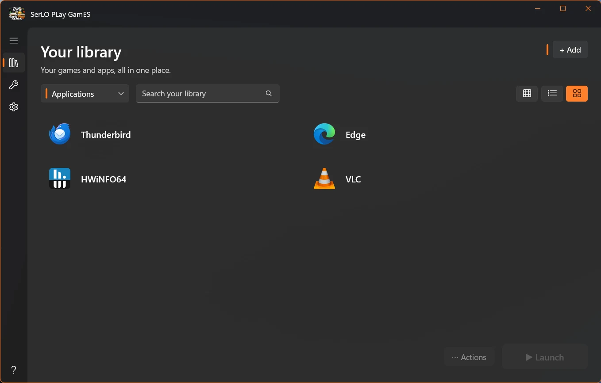
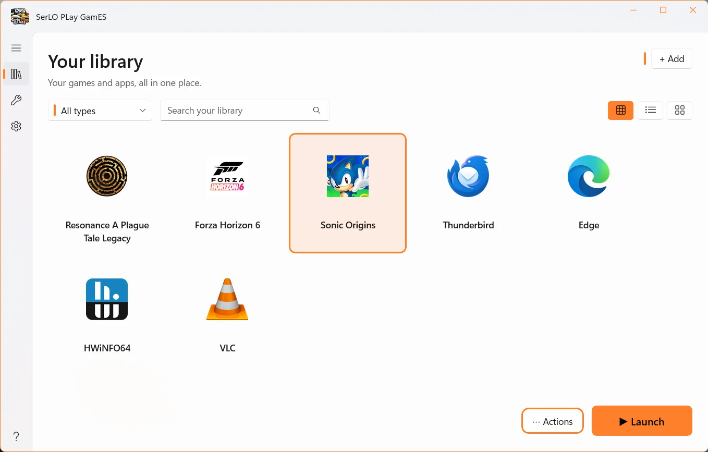

  

<h1 align="center">SerLO PLay GamES</h1>

<h3 align="center">Tus juegos. Tu espacio. Tus reglas.</h3>

  Una forma más cómoda de organizar, encontrar y ejecutar tus juegos y aplicaciones en Windows. 
  <strong>Todo lo que necesitas, en un solo lugar.</strong>

  <strong>Gratuito</strong> &nbsp;•&nbsp; Windows 10 y 11 (64 bits) &nbsp;•&nbsp; Español / English

  <a href="https://apps.microsoft.com/detail/9PG5GK35KVZV"><strong>Descargar en Microsoft Store</strong></a>
  &nbsp;·&nbsp;
  <a href="https://serlortrademark.github.io/serloplaygames/"><strong>Visitar la web oficial</strong></a>

  <a href="#español">Español</a> &nbsp;·&nbsp; <a href="#english">English</a>

---

## Español

### Tu biblioteca, a tu manera

**SerLO PLay GamES** reúne tus juegos, aplicaciones y accesos directos en un espacio personal desde el que puedes encontrarlos, organizarlos y ejecutarlos fácilmente. Una experiencia clara y personalizable, con todo al alcance de un clic.

### Todo lo que necesitas

- **Juegos y aplicaciones juntos:** organiza tu biblioteca, añade elementos manualmente y filtra por tipo.
- **Búsqueda automática de juegos:** localiza juegos instalados y elige cuáles incorporar. También puedes configurar carpetas de búsqueda.
- **Steam y accesos directos:** utiliza ejecutables y accesos compatibles, incluidos los de Steam.
- **Una biblioteca a tu gusto:** busca, reordena y edita elementos; alterna entre vistas de lista y tarjetas.
- **Iconos y apariencia:** usa iconos personalizados o automáticos, temas claro y oscuro y diferentes colores de acento.
- **Herramientas útiles:** actualiza iconos, elimina elementos que ya no se encuentran y restaura opciones cuando lo necesites.
- **Copias de seguridad:** exporta e importa tu biblioteca, configuración e iconos mediante archivos ZIP.
- **Dos idiomas:** interfaz en español e inglés.

### Descubre la aplicación

  
  

  
  

<a href="https://serlortrademark.github.io/serloplaygames/#capturas"><strong>Ver todas las capturas en la web oficial</strong></a>

Las marcas, nombres y logotipos de terceros que aparecen en las capturas pertenecen a sus respectivos titulares y se muestran únicamente como ejemplos.

### Gratis, desde Microsoft Store

**Todas las funcionalidades de SerLO PLay GamES son gratuitas.** No hay licencias de pago, suscripciones ni funciones que se desbloqueen mediante compras. El apoyo voluntario al proyecto es completamente opcional.

La aplicación se **instala y actualiza exclusivamente a través de Microsoft Store**. Requiere conexión a Internet para realizar la verificación de acceso al iniciarse.

**[Obtener SerLO PLay GamES en Microsoft Store](https://apps.microsoft.com/detail/9PG5GK35KVZV)**

Para conocerla mejor, visita la **[web oficial](https://serlortrademark.github.io/serloplaygames/)**.

---

## English

### Your library, your way

**SerLO PLay GamES** brings games, applications and shortcuts into one personal space, making them easy to find, organize and launch. A clean and customizable experience, with everything just a click away.

### Everything in one place

- **Games and apps together:** organize your library, add items manually and filter them by type.
- **Automatic game detection:** find installed games, choose which ones to add and customize search folders.
- **Steam and shortcuts:** launch executables and supported shortcuts, including Steam shortcuts.
- **Make it your own:** search, reorder and edit items, and switch between list and card views.
- **Icons and appearance:** choose custom or automatically assigned icons, light or dark themes, and accent colors.
- **Practical tools:** refresh icons, remove missing entries and restore options when needed.
- **ZIP backups:** export and import your library, settings and icons.
- **Two languages:** English and Spanish interfaces.

### See it in action

  
  

  
  

<a href="https://serlortrademark.github.io/serloplaygames/#capturas"><strong>Explore the full screenshot gallery</strong></a>

Third-party game and application names, brands and logos belong to their respective owners and are shown for illustration only.

### Free on Microsoft Store

**Every feature in SerLO PLay GamES is free.** There are no paid licenses, subscriptions or purchases required to unlock features. Voluntary support for the project is entirely optional.

The application is **installed and updated exclusively through Microsoft Store**. An Internet connection is required to verify access when starting the application.

**[Get SerLO PLay GamES on Microsoft Store](https://apps.microsoft.com/detail/9PG5GK35KVZV)**

Discover more on the **[official website](https://serlortrademark.github.io/serloplaygames/)**.

---

  <strong>Hecho para Windows, con pasión por lo que disfrutas.</strong> 
  <em>Made for Windows, with passion for what you love.</em>

© SerLO 2026

